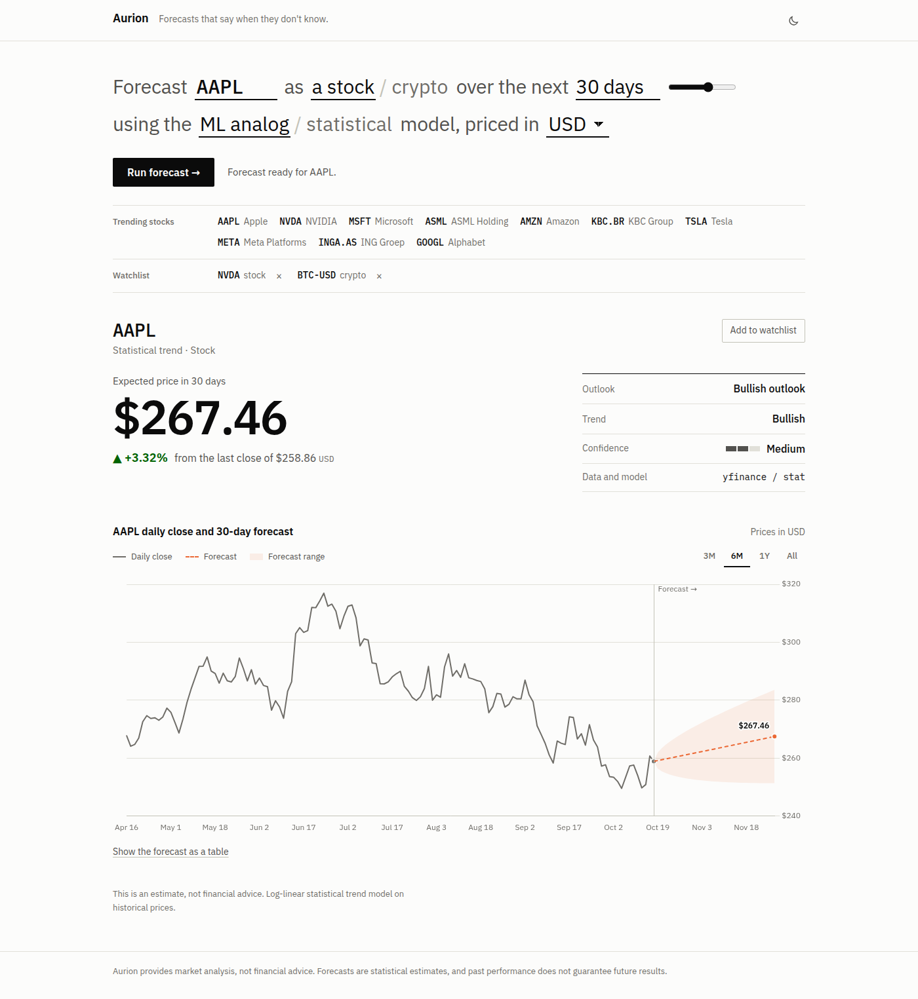
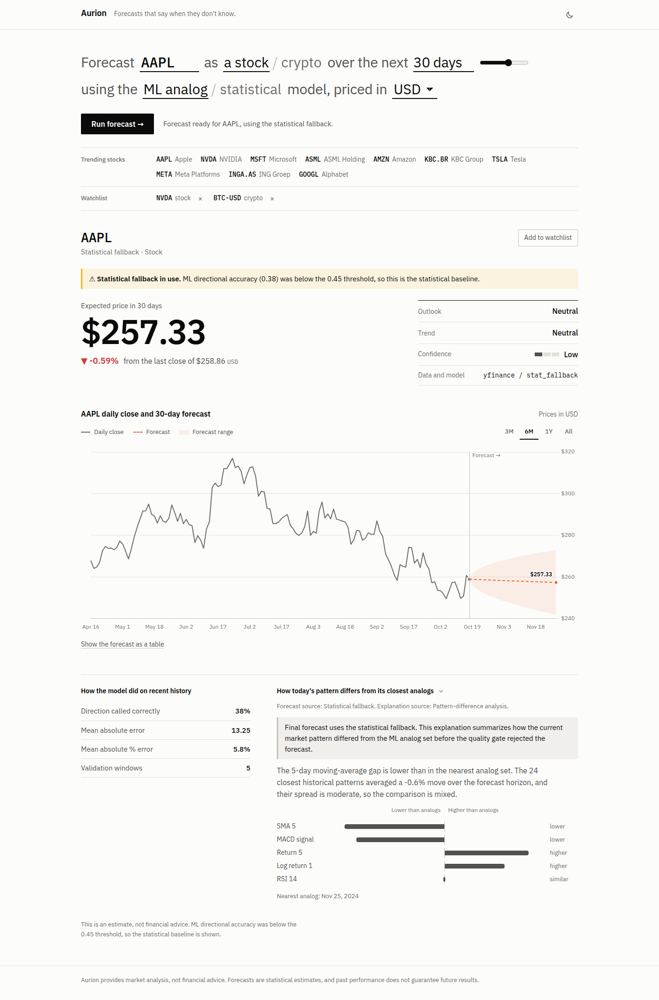
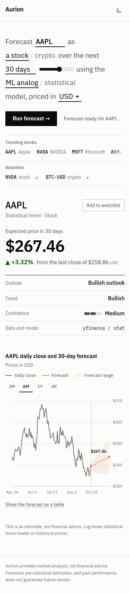
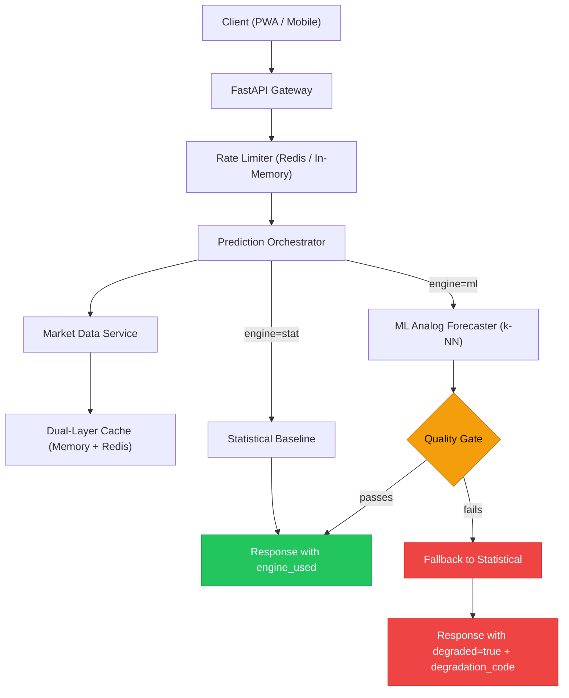

# Aurion

> Market forecasting that tells you when it doesn't know.

[](https://github.com/Davidvdv231/Aurion/actions/workflows/ci.yml)


Aurion is a multi-engine market forecasting system that combines statistical baselines and ML pattern matching with explicit quality gating and transparent degradation. When a model underperforms its benchmark, the system falls back honestly and tells you why. Built for trust under imperfect conditions, not prediction theater.

### Why this matters

Most forecasting tools either silently serve bad predictions or fail without explanation. Aurion takes a different approach: every prediction passes through a quality gate that checks directional accuracy, error margins, and validation depth. If the ML model can't beat a simple statistical baseline, the system says so explicitly — with a degradation code, a human-readable reason, and a fallback forecast. This makes the output trustworthy by default, not by assumption.

### Highlights

- **Multi-engine forecasting** — statistical baseline and k-NN analog pattern matching, with automatic engine selection
- **Quality gating with transparent fallback** — ML predictions are validated against baselines; failures degrade honestly with specific codes
- **Currency conversion** — server-side forex via yfinance, supporting 7 currencies with 1-hour cache
- **Observability** — structured JSON logging, Prometheus metrics, request tracing, and health/readiness probes

## Screenshots

Screenshots use illustrative price data.

**Statistical forecast: the query reads as a sentence, the expected price leads, and the chart shows the forecast range:**



**ML request that failed the quality gate: the fallback is stated up front, with the backtest and the pattern comparison below:**



**Mobile layout:**



## Architecture



## Design Decisions

| Decision | Choice | Trade-off |
|----------|--------|-----------|
| Forecasting approach | Multi-engine with quality gating | More complex orchestration, but honest about prediction quality |
| ML model | k-NN analog pattern matching | Simple and interpretable, but limited expressiveness vs. deep learning |
| Frontend framework | Vanilla JS PWA | Zero build step, instant deployment, but no component reuse |
| Rate limiting | Redis-backed with Lua atomic ops | Fail-closed in production (Redis failure = 503); bounded in-memory fallback in development |
| Caching | Dual-layer (memory + Redis) | Fast reads with persistence, but cache invalidation complexity |
| Currency conversion | Server-side via yfinance forex pairs | Real-time rates with 1-hour cache, supports USD/EUR/GBP/JPY/CHF/CAD/AUD |
| Request tracing | Request-ID middleware with sanitization | Every request gets a traceable ID in logs and response headers |

## Prediction Engine & Degradation

| Condition | Engine Used | Degraded | Code |
|-----------|------------|----------|------|
| Stat engine requested | `stat` | `false` | — |
| ML requested, quality passes | `ml` | `false` | — |
| ML requested, validation windows < 3 | `stat_fallback` | `true` | `model_validation_insufficient` |
| ML requested, directional accuracy < 0.45 | `stat_fallback` | `true` | `model_quality_insufficient` |
| ML requested, MAPE > statistical baseline MAPE or > no-change MAPE | `stat_fallback` | `true` | `model_baseline_underperforming` |
| ML requested, training timeout (>15s) | `stat_fallback` | `true` | `ml_engine_timeout` |
| ML requested, exception during training | `stat_fallback` | `true` | `ml_engine_unavailable` |

The no-change forecast holds the last close flat. It is scored on the same backtest windows as the model it is compared with, and a forecast that cannot beat it has no edge on recent history.

`evaluation` always describes the forecast that is returned: the ML backtest when the ML forecast is served, otherwise the statistical backtest (also after a fallback). `no_change_mape` is the error of the no-change forecast on those windows and `beats_no_change` says whether the returned forecast did better. It is `null` when there were too few rows to backtest.

Crypto defaults to the statistical engine: in walk-forward tests on BTC-USD and ETH-USD (2021–2026) the ML model called the 30-day direction correctly only 47% of the time and was less accurate than a no-change forecast. ML can still be requested explicitly (`"engine": "ml"`), and the quality gate above still applies.

## Example API Responses

**Clean ML prediction:**

```json
{
  "symbol": "AAPL",
  "asset_type": "stock",
  "currency": "USD",
  "native_currency": "USD",
  "display_currency": "USD",
  "engine_requested": "ml",
  "engine_used": "ml",
  "model_name": "Aurion Analog Forecaster",
  "degraded": false,
  "degradation_code": null,
  "degradation_message": null,
  "summary": {
    "expected_price": 198.45,
    "expected_return_pct": 2.3,
    "trend": "bullish",
    "confidence_tier": "medium",
    "signal": "Bullish Outlook"
  },
  "evaluation": {
    "mae": 3.21,
    "rmse": 4.15,
    "mape": 1.8,
    "directional_accuracy": 0.62,
    "validation_windows": 5,
    "no_change_mape": 2.05,
    "beats_no_change": true
  },
  "forecast": [
    {"date": "2026-04-07", "predicted": 194.82, "lower": 191.20, "upper": 198.44}
  ]
}
```

**Degraded ML to stat fallback:**

```json
{
  "symbol": "GME",
  "asset_type": "stock",
  "engine_requested": "ml",
  "engine_used": "stat_fallback",
  "degraded": true,
  "degradation_code": "model_quality_insufficient",
  "degradation_message": "ML directional accuracy (0.38) below threshold (0.45); using statistical fallback.",
  "summary": {
    "expected_price": 27.15,
    "expected_return_pct": -1.2,
    "trend": "bearish",
    "confidence_tier": "low",
    "signal": "Bearish Outlook"
  },
  "evaluation": {
    "mae": 1.85,
    "rmse": 2.34,
    "mape": 6.8,
    "directional_accuracy": 0.48,
    "validation_windows": 5,
    "no_change_mape": 6.5,
    "beats_no_change": false
  },
  "forecast": [
    {"date": "2026-04-07", "predicted": 27.42, "lower": 25.80, "upper": 29.04}
  ]
}
```

**Clean statistical baseline:**

```json
{
  "symbol": "BTC-USD",
  "asset_type": "crypto",
  "engine_requested": "stat",
  "engine_used": "stat",
  "degraded": false,
  "degradation_code": null,
  "summary": {
    "expected_price": 84250.00,
    "expected_return_pct": 1.8,
    "trend": "bullish",
    "confidence_tier": "medium",
    "signal": "Bullish Outlook"
  },
  "evaluation": {
    "mae": 2954.1,
    "rmse": 3610.7,
    "mape": 4.09,
    "directional_accuracy": 0.54,
    "validation_windows": 5,
    "no_change_mape": 3.69,
    "beats_no_change": false
  }
}
```

## API Reference

| Endpoint | Method | Purpose |
|----------|--------|---------|
| `/api/health` | GET | Liveness check — status, Redis health, cache size, uptime |
| `/api/health/ready` | GET | Readiness check — returns 503 when required internal dependencies are unavailable and reports runtime import checks |
| `/api/metrics` | GET | Prediction metrics snapshot (protected by `METRICS_TOKEN` when set) |
| `/api/tickers` | GET | Search tickers by query (1-50 results) |
| `/api/top-assets` | GET | Trending assets by type, cached 15 min |
| `/api/metrics/prometheus` | GET | Prometheus exposition format (protected by `METRICS_TOKEN` when set) |
| `/api/validation-summary` | GET | ML quality-gate thresholds and latest evaluation (protected) |
| `/api/predict` | POST | Multi-engine prediction with quality gating and degradation |

## Quick Start

```bash
# Clone and start
git clone https://github.com/Davidvdv231/Aurion.git
cd Aurion

# Run with Docker (includes Redis)
cp .env.example .env
docker compose -f infra/docker-compose.yml up --build

# Verify
curl http://localhost:8000/api/health

# Get a prediction (prices in USD)
curl -X POST http://localhost:8000/api/predict \
  -H "Content-Type: application/json" \
  -d '{"symbol": "AAPL", "asset_type": "stock", "engine": "stat", "horizon": 30}'

# Get a prediction with currency conversion
curl -X POST http://localhost:8000/api/predict \
  -H "Content-Type: application/json" \
  -d '{"symbol": "AAPL", "asset_type": "stock", "engine": "ml", "horizon": 30, "display_currency": "EUR"}'
```

For local development without Docker:

```bash
# Run from the repository root with Python 3.12: the code imports the `backend` package
python -m venv .venv
# Activate: source .venv/bin/activate (Windows: .venv\Scripts\Activate.ps1)
python -m pip install --require-hashes -r requirements-dev.lock
# Aurion validates client IPs itself, so Uvicorn must not rewrite them from proxy headers
python -m uvicorn backend.app:create_app --factory --reload --no-proxy-headers
```

Dependencies are locked: `backend/requirements.lock` (what Docker installs) and `requirements-dev.lock` (backend plus tooling, what CI installs) pin every transitive package with hashes. To change a dependency, edit `backend/requirements.txt` or `requirements-dev.txt` and run `make lock`; CI fails if the lockfiles are out of date.

For mobile development outside local Expo/device testing, set `EXPO_PUBLIC_API_BASE_URL` so the app can reach the deployed API. The mobile client only falls back to explicit demo data in development or when the live API is unavailable.

## Testing

```bash
# Run the backend and integration suite
python -m pytest tests -q

# Run with coverage
python -m pytest tests --cov=backend --cov-report=term-missing -q

# Type checking
python -m mypy backend

# Linting
python -m ruff check backend tests

# Formatting
python -m ruff format --check backend tests

# Mobile checks (from repository root)
npm --prefix mobile ci
npm --prefix mobile run typecheck
npm --prefix mobile test

# Frontend smoke test (requires Playwright browser install once)
python -m playwright install --with-deps chromium
python -m pytest tests/test_frontend_smoke.py -q

# Mobile smoke test: export the Expo web build, then click through it against a mocked API
(cd mobile && EXPO_PUBLIC_API_BASE_URL=http://api.aurion.test npx expo export --platform web --output-dir ../build/mobile-web)
MOBILE_WEB_EXPORT_DIR=build/mobile-web python -m pytest tests/test_mobile_web_smoke.py -q
```

The test suite covers API contracts, prediction orchestration, ML pipeline behavior, rate limiting, exchange rates, config, smoke integration, and browser-based smoke paths for the web app and for the Expo mobile app's web build (guest flow, live API data, crypto forecast). It also covers input validation, proxy spoofing, timeouts, corrupt market data, small crypto prices, ML cache invalidation, storage failures, keyboard interaction, stale responses and offline PWA use. Browser tests use deterministic market data and do not depend on live feeds. Tests isolate the developer's `.env`.

CI also type-checks the mobile client, runs its request/storage/formatting tests, audits both Python lockfiles, and blocks critical mobile npm advisories. High and moderate mobile advisories remain in the Expo toolchain; see [the engineering audit](docs/ENGINEERING_AUDIT.md). Passing CI does not mean those advisories are resolved.

See [deployment and operations](docs/OPERATIONS.md) for proxy trust, tokens, timeout budgets, container settings and known validation gaps.

## Tech Stack

| Layer | Technology | Purpose |
|-------|-----------|---------|
| API | FastAPI 0.135 / Python 3.12 | Async API with validation |
| ML | NumPy / pandas | k-NN analog pattern forecaster |
| Cache | Redis 7 + in-memory TTL | Dual-layer with configurable TTLs |
| Web | Vanilla JS PWA | Zero-dependency frontend with service worker |
| Mobile | React Native 0.88 / Expo 58 | Cross-platform mobile client |
| Market Data | yfinance | Historical market data and FX rate retrieval |
| CI/CD | GitHub Actions | Lint, type check, test, audit |
| Deploy | Docker + Docker Compose | Containerized with health checks |

## Known Limitations

- **ML model is k-NN analog** — simple by design, not a deep learning system. Effective for pattern matching, limited for complex market dynamics.
- **Market data via yfinance** — free and functional, but not a production-grade feed. Rate limits and data gaps may occur.
- **No persistent storage** — models and cache reset on container restart. No user database.
- **No user authentication** — stateless API, no multi-tenancy or user sessions. All three operational endpoints require `METRICS_TOKEN` in production; without it they return 503. Development access remains optional.
- **Mobile charting is lightweight** — the mobile app now renders a native forecast/history chart, but it is still less feature-rich than the web charting experience.
- **Mobile fallback mode is demo-only** — when the live API is unavailable, the app now labels demo data explicitly instead of pretending it is live.
- **Process-local models and metrics** — Kubernetes templates support multiple replicas, with Redis-backed shared rate limiting. Model training, memory caches and metrics remain local to each process.

## Engineering Trade-offs

- **Vanilla JS PWA over React/Vue** — zero build step means instant deployment and no framework churn, at the cost of no component reuse or state management.
- **k-NN analog over deep learning** — interpretable, fast to train on-demand, and honest about its limitations. Deep learning would need a training pipeline, GPU infra, and would be harder to explain.
- **In-memory metrics with Prometheus export** — lightweight counters with a `/api/metrics/prometheus` endpoint for external scraping. No full Prometheus client dependency.
- **Statistical fallback for ML failure** — ML failures use an already-computed baseline. Missing/invalid market data or an exhausted calculation budget still return an explicit API error.
- **Fail-closed rate limiting in production** — Redis failure yields 503 on protected market endpoints. Development falls back to bounded in-memory limiting when enabled.
- **Thread pool for blocking tasks** — avoids blocking the async event loop, but adds concurrency limits (8 workers default).

## Project Status

Aurion is a solo-built MVP. The prediction orchestration, degradation semantics, currency conversion, and web PWA are production-minded — designed with real deployment patterns (rate limiting, health probes, structured logging, security headers) but scoped as a portfolio-grade MVP, not a scaled production system. The ML model is functional but would still benefit from deeper validation on more volatile assets. The mobile app (React Native/Expo) covers the core prediction flow, watchlist, currency selection, explicit degradation handling, and a native chart view, but it still does not have full feature parity with the web client and there is no offline-first sync.

**Current focus:** hardening cross-stack consistency — keeping backend, web, mobile, CI, and docs aligned around one honest prediction contract.

## License

MIT
